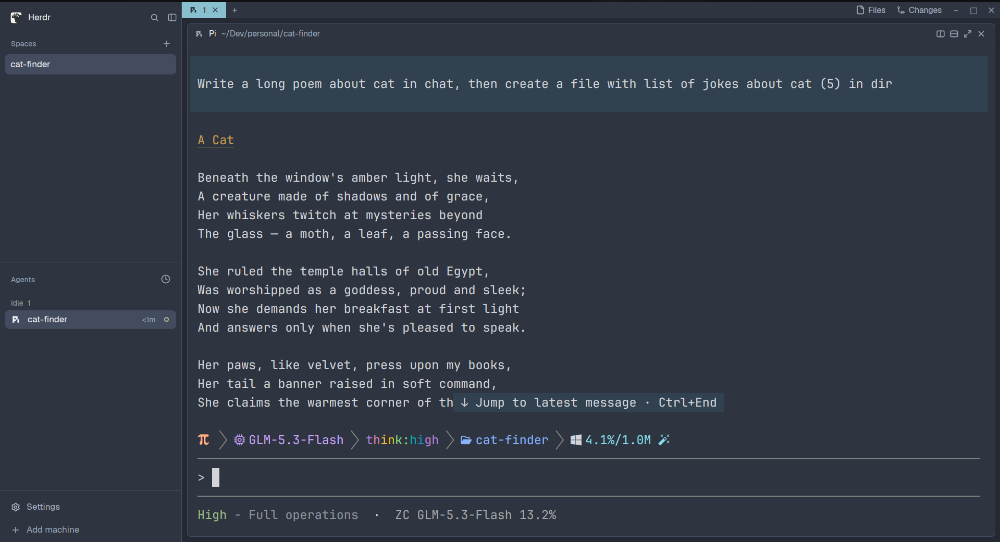

# Nord for Herdr

A Nord layout for [Herdr](https://herdr.dev). The whole interface on the Nord palette, with every color pair measured against the surface it renders on.



## Install

Run Herdr once so it creates its config folder, then:

```sh
git clone https://github.com/udit-001/herdr-nord.git
cd herdr-nord
./install.sh
```

The script copies the layout and its twelve mods into `~/.config/herdr-app`, checks each mod, and switches your window to it. Nothing outside that folder is touched. To remove it, switch to another layout and delete `layouts/square-nord.json` plus the `mods/square-nord-*` folders.

## What you get

- **Whole-interface theme** — sidebar, tab bar, Files and Changes panels, picker, menus, pane headers, and terminals all carry the Nord palette as one self-contained theme. Your other layouts keep theirs.
- **Measured contrast** — muted and dim text, status colors, and the active tab were checked against every surface they render on, and the fixes live in the theme tokens rather than in individual screens.
- **Status that survives its background** — working, blocked, and done cues stay readable on dark panes and on the cyan active tab alike.
- **Rounded cards** — terminals and side panels sit as 6px cards on the canvas, with draggable borders and a quiet focus treatment.
- **Sidebar pills** — spaces and agents select as inset rounded rows, with sort, pin, and collapse controls on hover.
- **Keyboard Changes** — the Changes panel takes arrow-key and Enter navigation, Escape clears, and reads hunk headers and line numbers in theme colors.

## Requirements

- Herdr 0.1.7 or newer, with herdr-core running
- Git, for the Files and Changes panels

The layout ships no fonts of its own and uses whatever your Herdr settings already specify.

## Credits

The layout and mods are modified versions of the mods shipped with [Herdr 0.1.7](https://github.com/herdrdev/herdr-app), under the Apache-2.0 license. See [NOTICE](NOTICE).
